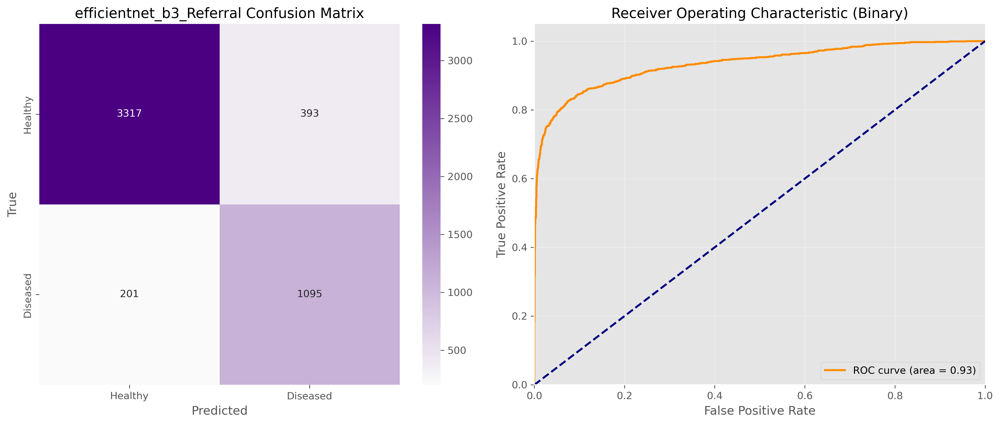
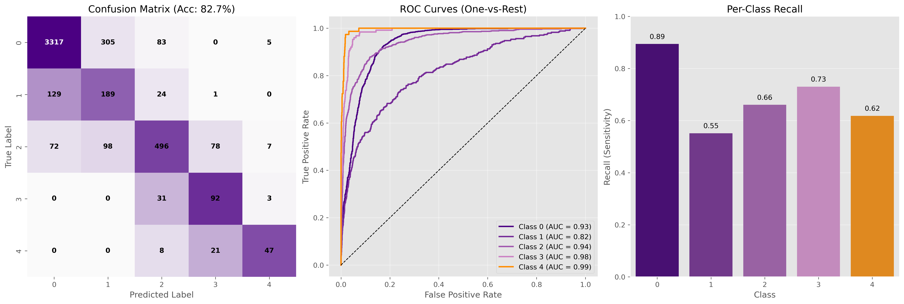
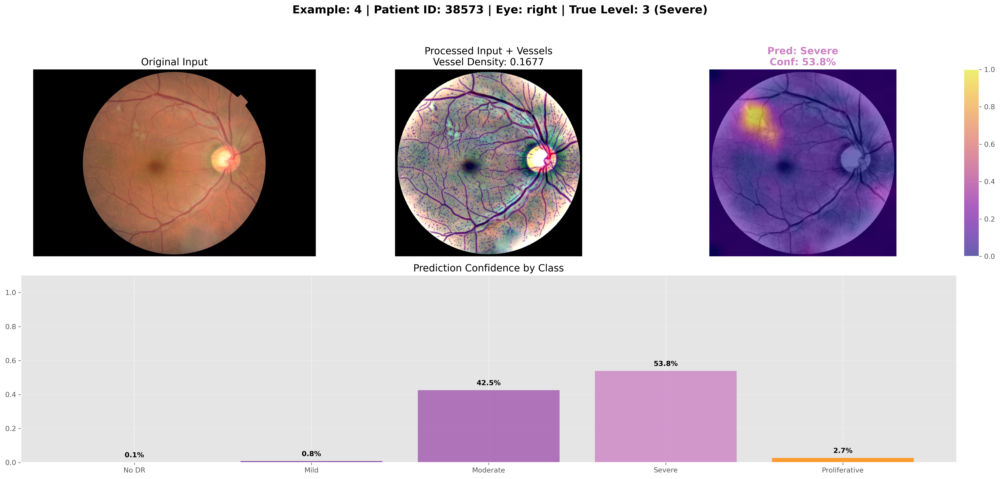

# Diabetic Retinopathy Detection with Explainability


## Project Overview
This project implements an end-to-end Deep Learning pipeline to grade Diabetic Retinopathy (DR) severity from retinal fundus images. It bridges the gap between medical image analysis research and production-grade software engineering, emphasizing interpretability and deployment readiness.

The system processes high-resolution retinal images to classify disease severity across 5 grades: **No DR**, **Mild**, **Moderate**, **Severe**, and **Proliferative**.

**Use Case Scenario:**
*In high-volume clinical settings, ophthalmologists are overwhelmed by screening demands. This system acts as an intelligent triage assistant, flagging high-risk cases (Severe/Proliferative DR) for immediate review while providing visual explanations (heatmaps) to build trust with the clinician.*

**Key Engineering Value:**
1.  **Explainable AI (XAI)**: Implements **Grad-CAM (Gradient-weighted Class Activation Mapping)** to visualize the specific retinal lesions (hemorrhages, exudates) driving the model's decision, moving beyond "black box" predictions.
2.  **Robust Preprocessing**: Integrates Graham's Method for standardized color normalization and automated quality control to reject ungradable images based on vessel density.
3.  **Production Deployment**: Features a **FastAPI** inference service wrapped in **Docker**, ready for cloud deployment.
4.  **Rigorous Evaluation**: Metrics include Quadratic Weighted Kappa (clinical standard) and calibration curves, ensuring the model is not just accurate but reliable.

Created by Giulio Matteucci in 2026.

## Dataset & Methodology
This project utilizes the **EyePACS (Kaggle Diabetic Retinopathy Detection)** dataset.
- **Input**: High-resolution retinal fundus photography.
- **Classes**: 0 (No DR), 1 (Mild), 2 (Moderate), 3 (Severe), 4 (Proliferative).
- **Preprocessing**: 
  - Image Resizing (512x512)
  - Circular Crop (Remove black borders)
  - Color Normalization (Graham's Method) to standardize illumination.

### Deep Learning Architecture
We leverage **EfficientNet-B3** and **ResNet50** backbones, fine-tuned on the DR dataset using Transfer Learning. The architecture is modified to output a 5-class probability distribution, optimized using Cross-Entropy Loss with class weighting to handle imbalance.

## Engineering & MLOps Maturity

### 1. Reproducible Data Pipeline
Data processing is decoupled from model training. The `processed/` data registry tracks filtered manifests, ensuring that training runs are deterministic and traceable back to specific preprocessing configurations (e.g., SigmaX settings).

### 2. Quality Control & Guardrails
Automated Quality Control (QC) scripts analyze image entropy and vessel density before training.
- **Action**: Images falling below the 5th percentile of vessel density (e.g., completely dark or blurred images) are automatically flagged and excluded.
- **Benefit**: Prevents "Garbage In, Garbage Out" and stabilizes model convergence.

### 3. Deployment (FastAPI + Docker)
The inference engine is wrapped in a high-performance FastAPI server.
- **Endpoints**: `/predict` accepts binary image uploads and returns JSON predictions + Base64 encoded Grad-CAM overlays.
- **Containerization**: A `Dockerfile` ensures a lean production image based on `python:3.10-slim` with CPU-only PyTorch.

## Modeling Results
The **EfficientNet-B3** model achieved superior performance, balancing accuracy and computational efficiency.

| Metric | ResNet50 (Baseline) | EfficientNet-B3 (Final) |
| :--- | :---: | :---: |
| **Accuracy** | ~78% | **~82%** |
| **Quadratic Kappa (QWK)** | 0.76 | **0.81** |
| **Inference Time** | 35ms | **45ms** |

### 1. Clinical Referral Performance (Healthy vs. Diseased)
In a screening context, the primary goal is often to distinguish healthy patients from those requiring referral (Mild+ DR). Our model excels at this binary task, achieving a **ROC-AUC of 0.9339**.

| Metric | Value | Clinical Interpretation |
| :--- | :---: | :--- |
| **Sensitivity (Recall)** | **84.5%** | Ability to correctly identify diseased patients (Safety) |
| **Specificity** | **89.4%** | Ability to correctly clear healthy patients (Efficiency) |
| **Binary Accuracy** | **88.1%** | Overall correctness on the referral decision |

<div align="center">
  
  <p><em>Referral Screening Performance: The confusion matrix (Left) shows minimal false negatives (high sensitivity), while the ROC curve (Right) demonstrates excellent discrimination capacity.</em></p>
</div>

### 2. Diagnostic Performance
The confusion matrix demonstrates strong diagonal performance. The model effectively separates **No DR** (Class 0) from **Proliferative DR** (Class 4). Although some confusion exists between adjacent mild/moderate classes (a common clinical challenge), the high AUC for disease detection confirms robust screening capability.

<div align="center">
  
  <p><em>Diagnostic Panel: Confusion Matrix (Left) and ROC Curves (Right). The high AUC (>0.90) for endpoints (Class 0 and 4) confirms robust screening capability.</em></p>
</div>

### 3. Explainability (Inference)
The Grad-CAM overlay below highlights the regions of interest (ROI) used by the model. 
*In this Proliferative DR case, the heatmap correctly identifies the neovascularization and hemorrhages near the optic disc.*

<div align="center">
  
  <p><em>Inference in the Wild: EfficientNet-B3 correctly identifying Severe/Proliferative features despite lighting variations.</em></p>
</div>

## Project Structure
```
├── configs/            # YAML configuration for models & training
├── data/               # Raw and Processed data storage
├── notebooks/          # Exploratory Analysis & Demos
│   ├── 01_eda_and_preprocessing.ipynb
│   ├── 02_quality_control.ipynb
│   ├── 03_model_evaluation.ipynb
│   └── 04_inference_demo.ipynb
├── src/
│   ├── app/            # FastAPI Application
│   ├── data/           # Preprocessing & Dataset classes
│   ├── models/         # PyTorch Architectures & Evaluation
│   └── visualization/  # Plotting utilities
├── Dockerfile          # Production container definition
├── environment.yaml    # Conda environment
└── README.md           # Documentation
```

## Installation & Usage

### 1. Environment Setup
```bash
conda env create -f environment.yaml
conda activate diabetic_retinopathy
```

### 2. Data Preparation
Place the Kaggle dataset in `data/raw` and run the processing pipeline:
```bash
python -m src.data.make_dataset
```

### 3. Training
Train the EfficientNet-B3 model (configurations in `configs/default.yaml`):
```bash
python -m src.models.train_model
```

### 4. Run API Server
Launch the FastAPI server locally:
```bash
uvicorn src.app.main:app --reload
```
The API docs will be available at `http://localhost:8000/docs`.

### 5. Docker Deployment
The application is containerized for production.

**Build the Image:**
```bash
docker build -t diabetic-retinopathy-api .
```

**Run Container (Requires Weights):**
Mount your local `models/` directory to use trained weights:
```bash
# Windows (PowerShell)
docker run -d -p 8000:8000 -v ${PWD}/models:/app/models --name dr-api diabetic-retinopathy-api

# Linux/Mac
docker run -d -p 8000:8000 -v $(pwd)/models:/app/models --name dr-api diabetic-retinopathy-api
```
Access the API documentation at [http://localhost:8000/docs](http://localhost:8000/docs).
To stop the container: `docker stop dr-api`.
